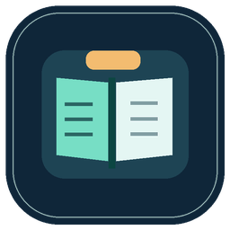
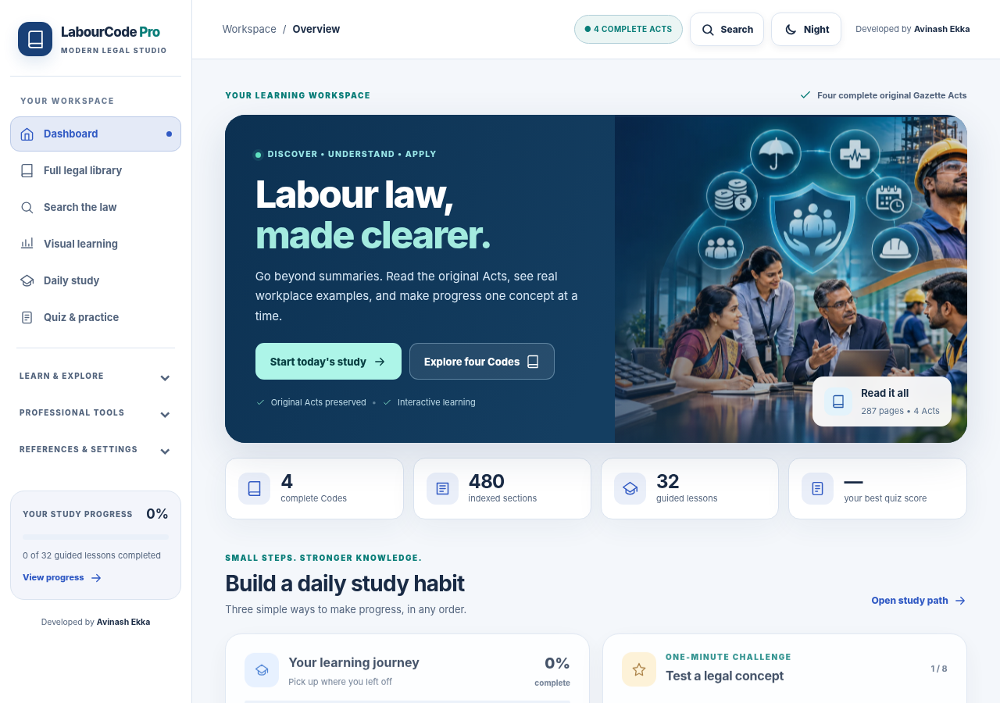
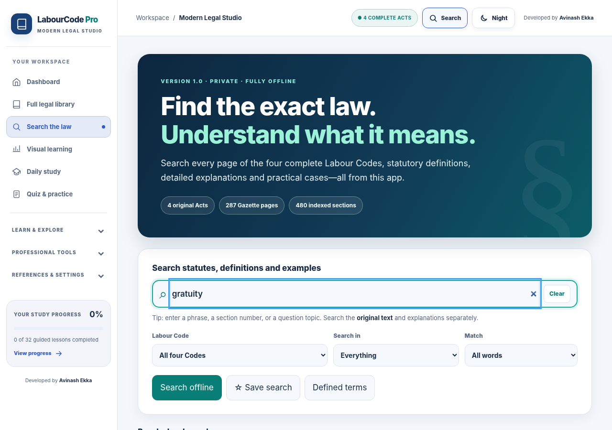
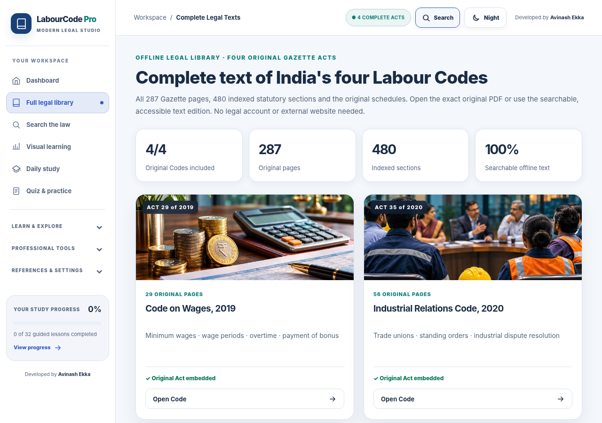
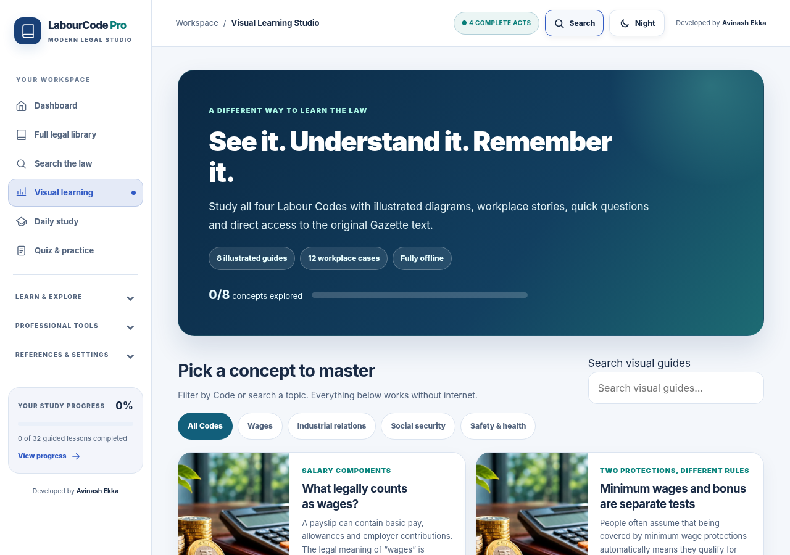
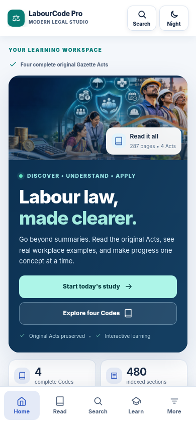
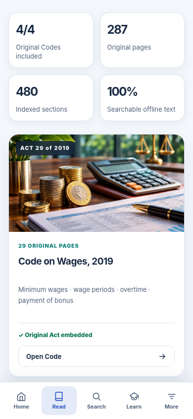
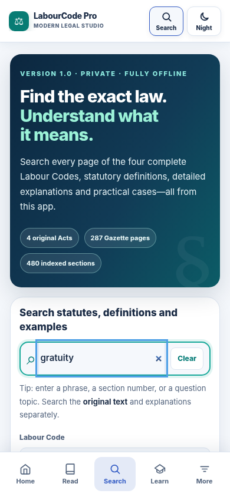
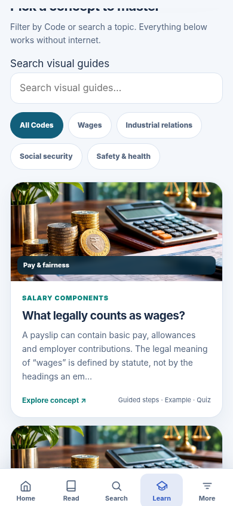

<div align="center">
  

# LabourCode Pro
### Modern Legal Studio · Interactive Indian Labour Law Learning

**Four complete original Labour Codes · Clear explanations · Visual learning · Practical assessments**

A thoughtfully designed, installable web app that helps people read, understand and study India's four Labour Codes.

**Developed by Avinash Ekka**
</div>

---

## Discover the modern learning experience



The updated interface combines a spacious professional layout, readable legal content, focused navigation and an engaging learning journey. Use the interactive one-minute challenge, explore legal concepts visually and return to the exact original statutory texts whenever you need them.

### Inside the app

<table>
  <tr>
    <td width="50%"><br/><b>Search original statutory texts</b></td>
    <td width="50%"><br/><b>Complete Gazette library</b></td>
  </tr>
  <tr>
    <td colspan="2"><br/><b>Visual Learning Studio</b></td>
  </tr>
</table>

### Designed for phones, tablets and desktops

<table>
  <tr>
    <td width="25%"><br/><b>Home</b></td>
    <td width="25%"><br/><b>Read</b></td>
    <td width="25%"><br/><b>Search</b></td>
    <td width="25%"><br/><b>Learn</b></td>
  </tr>
</table>

## The complete original Labour Codes

| Statutory Act | Original pages | Indexed sections |
|---|---:|---:|
| Code on Wages, 2019 | 29 | 69 |
| Industrial Relations Code, 2020 | 56 | 104 |
| Code on Social Security, 2020 | 116 | 164 |
| Occupational Safety, Health and Working Conditions Code, 2020 | 86 | 143 |
| **Total** | **287** | **480** |

The original Gazette PDFs, including schedules, are stored in the application. They are kept separate from simplified explanations and remain available for direct reading and download. The searchable text layer makes it easier to locate provisions, definitions and specific sections.

## What you can do

- **Read with confidence:** Open the four complete original Acts, switch to reflowed text or use the browser's PDF viewing and zoom controls.
- **Find words instantly:** Search full-text legislation, phrases, sections, detailed definitions, lessons and examples, with filters and saved searches.
- **Study in small steps:** Follow a three-part learning journey, a daily study path and a one-minute home-screen concept challenge with explanations.
- **See the concepts:** Explore 8 illustrated concept guides, interactive diagrams and wage examples.
- **Practise and remember:** Work through 32 guided lessons, 12 workplace cases, 60 curated glossary explanations and a 312-question assessment bank.
- **Explore HR scenarios:** Try educational calculation labs, compliance-review checklists and source-linked research tools.
- **Make it yours:** Choose light or dark mode, adjust reading preferences and save learning progress in local browser storage.
- **Install for easy access:** Add the Progressive Web App (PWA) to a compatible device and use core content offline after the initial assets are cached.

## Designed around reading and understanding

The **Modern Legal Studio** refresh uses a professional navy-and-blue colour system, teal progress accents, carefully balanced white reading surfaces, clearer typography, purpose-driven motion and simplified navigation. The home page offers useful next steps immediately without taking over the screen with multiple promotional banners. Motion respects system reduced-motion preferences.

## Run locally

The project uses a dependency-free static website and a small local preview server. With Node.js 18+:

```bash
npm start
```

Open `http://127.0.0.1:4173` in a browser. The website itself is in [`site/`](site/). GitHub Pages deployment is included in [`.github/workflows/deploy-pages.yml`](.github/workflows/deploy-pages.yml).

## Privacy and legal accuracy

The four bundled Gazette Acts preserve the **original 2019 and 2020 enacted texts**, not a continuously updated consolidated law database. Later amendments, commencement notifications and Central/State rules may affect the operative position. Simplified explanations, quizzes, calculators and compliance scenarios are provided for education and do **not** replace professional legal advice or a verified compliance determination.

No user account is needed for the core legal reader and study modules. Learning progress is saved locally on your device; an optional external AI service must be separately configured before use.

See [Privacy](PRIVACY.md), [Security](SECURITY.md) and [Legal Notice](NOTICE.md).

---

<div align="center">

### LabourCode Pro — Read the law. Understand it visually. Keep learning.
**Developed by Avinash Ekka**

</div>
