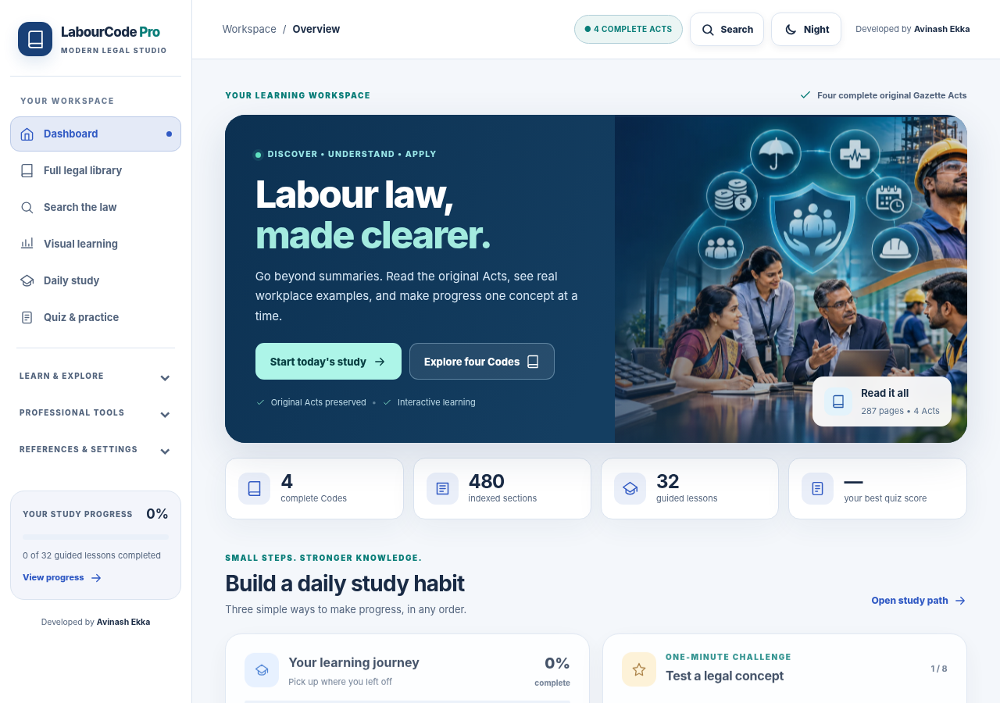
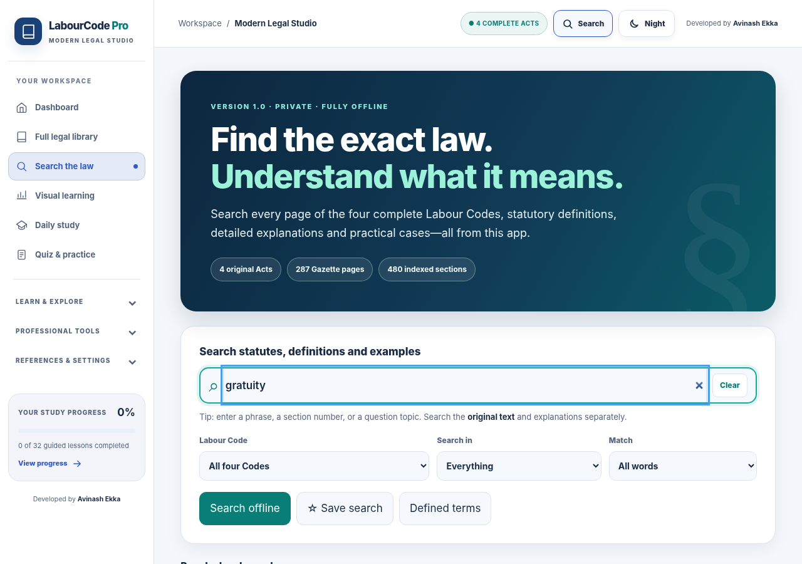
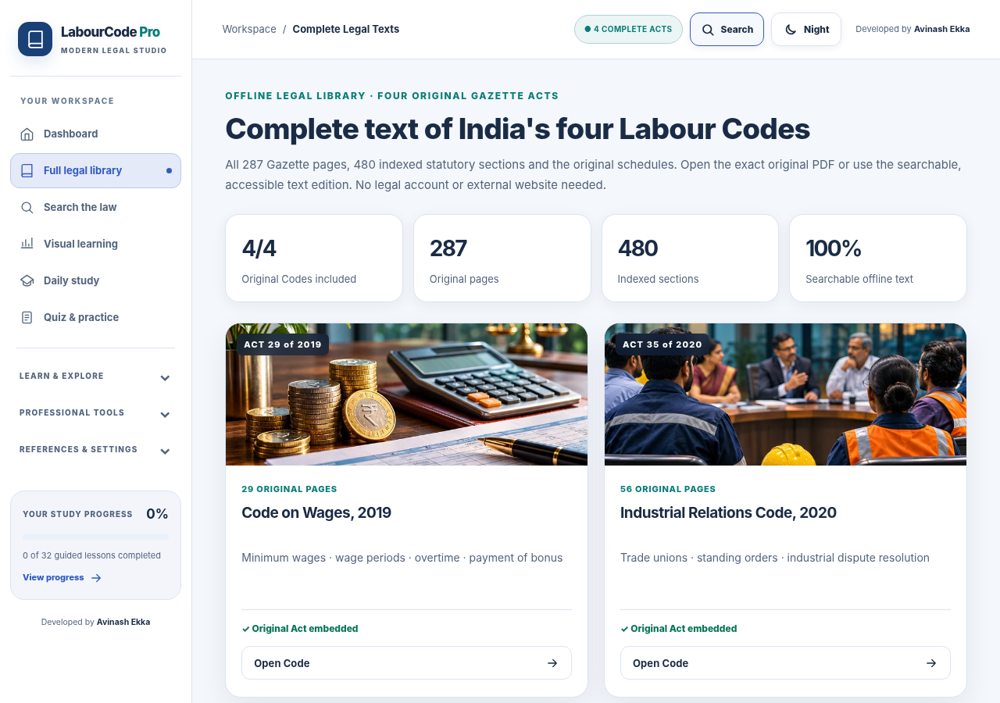
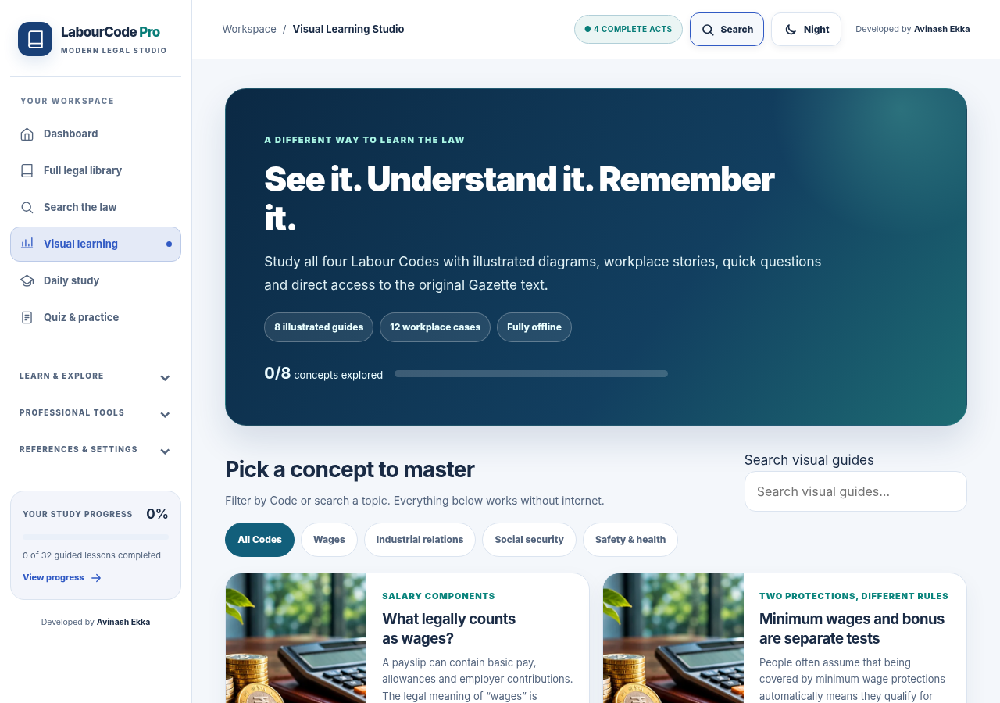
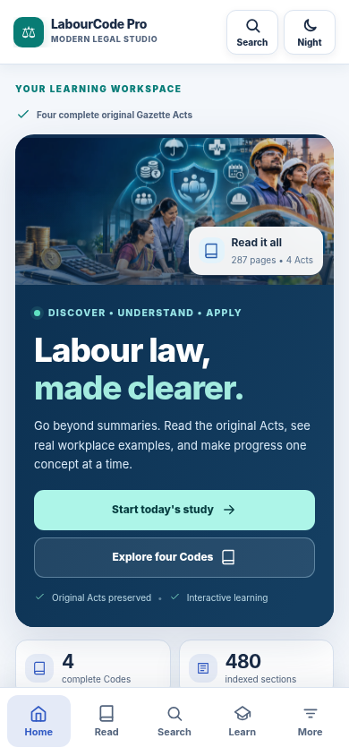
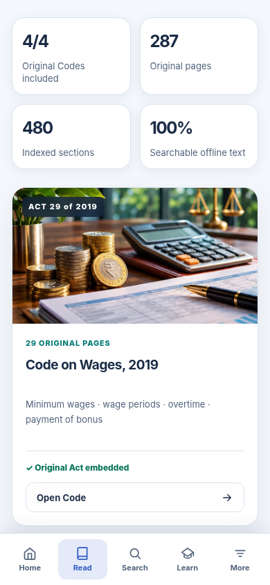
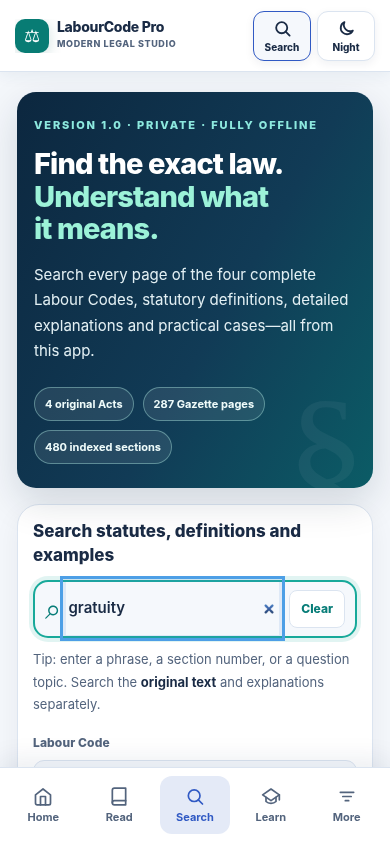
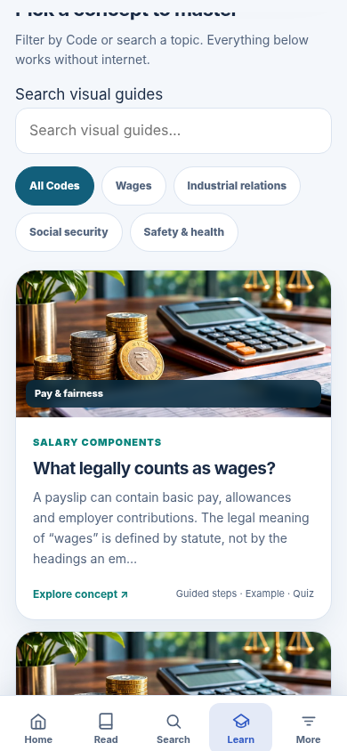

# Screenshots · LabourCode Pro Modern Legal Studio

The images below are captured from the functioning web interface in headless Chromium at desktop and mobile viewport sizes. They do not represent a native Android build.

## Desktop

### Modern learning dashboard

### Search the four complete Acts

### Original Gazette library

### Visual Learning Studio

## Mobile

| Home | Full Acts |
|---|---|
|  |  |

| Legal search | Visual learning |
|---|---|
|  |  |
